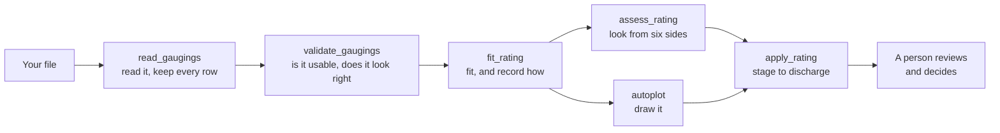
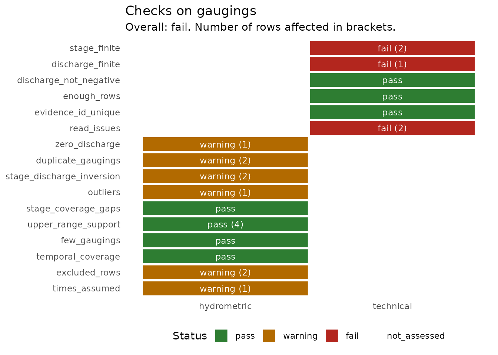
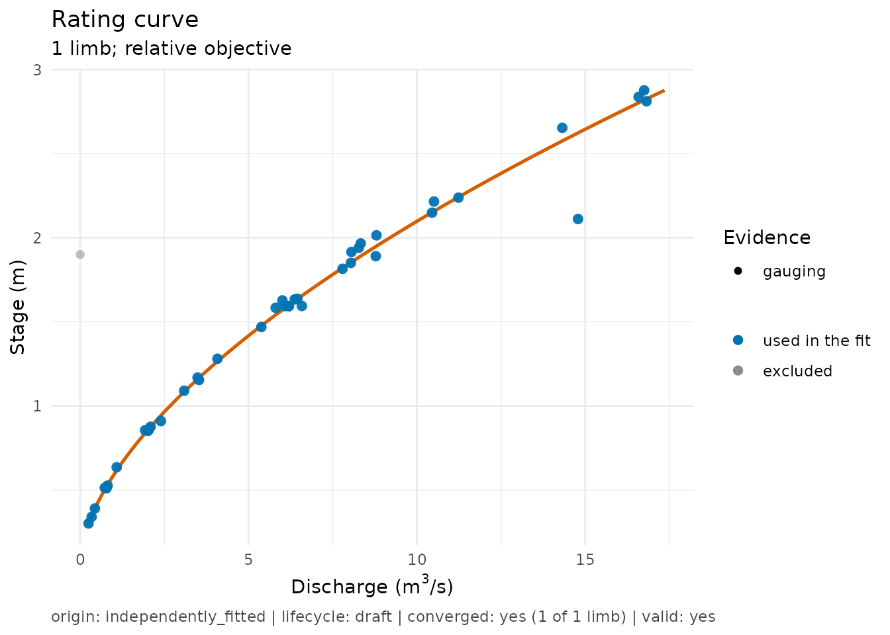

# Start Here: From a File of Gaugings to a Rating

**Audience:** novice. You have a file of spot gaugings and want a rating
from it. No knowledge of the package, of S7 or of the mathematics is
assumed; terms are explained where they first appear, and
[`vignette("glossary")`](https://jonpayneea.github.io/reach.rate/articles/glossary.md)
lists them all.

This page takes one file from start to finish. The file is synthetic, a
made-up station called Example Weir, in the layout of an Environment
Agency gauging export. It has a few faults in it on purpose, because a
real archive does, and you will see what the package does about each.



The diagram shows the route. Every step keeps what the one before found,
and none of them removes a row from your data. At the end a person
decides whether the rating is fit to use. The package never makes that
decision for you.

## Your file

``` r

path <- system.file("extdata", "example_gaugings.csv", package = "reach.rate")
cat(readLines(path, n = 6), sep = "\n")
#> "Station number","Station name","Date","Time","Stage","Flow","Remark"
#> "TEST001","Example Weir","24/03/2014","16:45:00","0.301","0.2487",""
#> "TEST001","Example Weir","07/07/2014","13:00:00","0.340","0.3401",""
#> "TEST001","Example Weir","04/08/2014","12:00:00","0.390","0.4378",""
#> "TEST001","Example Weir","13/09/2014","09:45:00","0.510","0.7807",""
#> "TEST001","Example Weir","01/12/2014","09:15:00","0.513","0.7309",""
```

Each row is one spot gauging: a stage in metres and a discharge in cubic
metres per second, measured together at one time. A **rating curve** is
the relationship between them, so that a stage reading, which is easy to
measure continuously, can be turned into a discharge, which is not.

## Read it

``` r

gaugings <- read_gaugings(path)
#> read_gaugings(): 43 rows, 1 stations, date format %d/%m/%Y.
#>   Rows with a note: 3. Most common: discharge missing (1), stage missing (1), stage not a number (1), time missing, midnight assumed (1).
```

[`read_gaugings()`](https://jonpayneea.github.io/reach.rate/reference/read_gaugings.md)
reads every column as text and then turns it into numbers and dates one
step at a time, so that a problem is noted on its own row and not
silently dropped or changed. It tells you what it found:

``` r

read_summary(gaugings)
#>                             issue n_rows share_of_rows
#>                            <char>  <int>         <num>
#> 1:              discharge missing      1    0.02325581
#> 2:                  stage missing      1    0.02325581
#> 3:             stage not a number      1    0.02325581
#> 4: time missing, midnight assumed      1    0.02325581
gaugings[!is.na(read_issue), .(source_row, stage_original, discharge_original, read_issue)]
#>    source_row stage_original discharge_original
#>         <int>         <char>             <char>
#> 1:          7            ---                ---
#> 2:         15         1.138m             3.4501
#> 3:         40          2.811            16.8201
#>                          read_issue
#>                              <char>
#> 1: stage missing; discharge missing
#> 2:               stage not a number
#> 3:   time missing, midnight assumed
```

`---` is a placeholder for “no value” and `1.60m` has a unit stuck to
it. Both are kept, with the original text beside them, and each row says
what was wrong. Nothing has been removed or corrected.

## Check it

``` r

checks <- validate_gaugings(gaugings, reference_time = as.POSIXct("2025-01-01", tz = "UTC"))
checks
#> <FlodeAssessment> gaugings, 43 row(s) assessed. Overall: fail
#>   7 pass, 6 warning, 3 fail, 0 not assessed
#>   [fail] stage_finite: 2 rows have a stage that is missing or not finite.
#>   [fail] discharge_finite: 1 row has a discharge that is missing or not finite.
#>   [fail] read_issues: 2 rows have a note from reading the file (for example: stage missing; discharge missing).
#>   [warning] zero_discharge: 1 gauging has a discharge of zero. A rating on relative error cannot use them.
#>   [warning] duplicate_gaugings: 2 gaugings are an exact duplicate of another.
#>   [warning] stage_discharge_inversion: 2 gaugings are part of a stage-discharge inversion: a discharge more than 20% below that of a gauging at a lower stage.
#>   [warning] outliers: 1 gauging lies off the curve of its neighbours in stage.
#>   [warning] excluded_rows: 2 rows are marked as excluded.
#>   [warning] times_assumed: 1 gauging has no time of day, so midnight was assumed.
```

There are two kinds of finding. A **fail** means the data cannot be used
as it stands, such as a stage that is not a number. A **warning** is a
judgement for you to make, such as a gauging that is far from its
neighbours. The check never removes anything; it names the rows
concerned so you can look.

``` r

assessment_checks(checks)[status %in% c("fail", "warning"), .(check_id, status, message)]
#>                     check_id  status
#>                       <char>  <char>
#> 1:              stage_finite    fail
#> 2:          discharge_finite    fail
#> 3:               read_issues    fail
#> 4:            zero_discharge warning
#> 5:        duplicate_gaugings warning
#> 6: stage_discharge_inversion warning
#> 7:                  outliers warning
#> 8:             excluded_rows warning
#> 9:             times_assumed warning
#>                                                                                                                    message
#>                                                                                                                     <char>
#> 1:                                                                      2 rows have a stage that is missing or not finite.
#> 2:                                                                    1 row has a discharge that is missing or not finite.
#> 3:                               2 rows have a note from reading the file (for example: stage missing; discharge missing).
#> 4:                                          1 gauging has a discharge of zero. A rating on relative error cannot use them.
#> 5:                                                                           2 gaugings are an exact duplicate of another.
#> 6: 2 gaugings are part of a stage-discharge inversion: a discharge more than 20% below that of a gauging at a lower stage.
#> 7:                                                                1 gauging lies off the curve of its neighbours in stage.
#> 8:                                                                                          2 rows are marked as excluded.
#> 9:                                                                  1 gauging has no time of day, so midnight was assumed.
plot(checks)
```



Look at the two rows the outlier and zero-discharge checks point to
before you go on. In a real archive you would go back to the paper
record. Here we know one was entered 60% too high and one is a dry pool.

## Fit a rating

``` r

fit <- fit_rating(gaugings)
#> fit_rating(): 40 of 43 rows used; relative objective, independent model, one limb.
#>   Not used: 1 (stage missing; discharge missing); 1 (stage not a number); 1 (zero discharge).
#>   No operational limits set: the rating applies only within the gauged range. See set_operational_limits().
fit
#> <FlodeRating> 1 limb(s), origin: independently_fitted, lifecycle: draft
#>   converged: yes (1 of 1 limb)
#>   valid: yes
#>   breakpoints: one limb
#>   evidence: 40 of 43 rows used
#>   operational limits: not set; applies only within the gauged range 0.301 to 2.876 m
#>     limb lower_stage_m upper_stage_m        C          a       n  rmse_cms
#>    <int>         <num>         <num>    <num>      <num>   <num>     <num>
#> 1:     1         0.301         2.876 3.009912 0.06841777 1.69713 0.7886304
#>    r_squared
#>        <num>
#> 1: 0.9722328
```

[`fit_rating()`](https://jonpayneea.github.io/reach.rate/reference/fit_rating.md)
makes choices a careful analyst would not argue with, and says what they
were. It fits **one limb**, one equation \\Q = C\\(H - a)^n\\ over the
whole range, because a rating with several limbs is a decision about the
river that you should make, not the software. It fits on the
**relative** objective, because gauging error is usually proportional to
the reading. And it leaves out the rows it cannot use, listing each with
its reason:

``` r

rating_provenance(fit)$fit_rating$excluded[, .(evidence_id, reason)]
#>    evidence_id
#>         <char>
#> 1:        G007
#> 2:        G015
#> 3:        G030
#>                                                                                                     reason
#>                                                                                                     <char>
#> 1:                                                    marked as excluded: stage missing; discharge missing
#> 2:                                                                  marked as excluded: stage not a number
#> 3: zero discharge: the relative objective needs positive discharge (use objective = "absolute" to keep it)
```

The printed rating also says whether the optimiser **converged** and
whether the equations are **valid**. They are separate questions, and
both should be yes.

## Look at it

``` r

autoplot(fit)
```



The curve runs through the gaugings. Evidence that is not a gauging
would have a different shape, and rows left out of the fit are drawn
grey and faint, not hidden. The caption gives the rating’s status.

## Assess it

``` r

assessment <- assess_rating(fit, reference_time = as.POSIXct("2025-01-01", tz = "UTC"))
assessment
#> <FlodeAssessment> rating, 40 row(s) assessed. Overall: warning
#>   38 pass, 6 warning, 0 fail, 2 not assessed
#>   data:        12 pass, 4 warning, 0 fail, 0 not assessed
#>   numerical:   8 pass, 0 warning, 0 fail, 1 not assessed
#>   statistical: 8 pass, 0 warning, 0 fail, 0 not assessed
#>   hydraulic:   5 pass, 0 warning, 0 fail, 0 not assessed
#>   operational: 1 pass, 1 warning, 0 fail, 1 not assessed
#>   provenance:  4 pass, 1 warning, 0 fail, 0 not assessed
#>   [warning] duplicate_gaugings: 2 gaugings are an exact duplicate of another.
#>   [warning] stage_discharge_inversion: 1 gauging is part of a stage-discharge inversion: a discharge more than 20% below that of a gauging at a lower stage.
#>   [warning] outliers: 1 gauging lies off the curve of its neighbours in stage.
#>   [warning] times_assumed: 1 gauging has no time of day, so midnight was assumed.
#>   [warning] operational_limits_stated: No operational limits are stated for this rating.
#>   [warning] evidence_assumptions: Converted from a plain table; filled evidence_id, site_id, source_type, source_name, source_version, quality_code, notes, exclusion_reason, included, weight, metadata. source_type assumed 'gauging', weight assumed 1, included TRUE unless stage or discharge is missing.
#>   [not_assessed] interval_ordering: No bootstrap draws, so interval ordering could not be checked.
#>   [not_assessed] extrapolation_extent: No limits are stated, so their extent cannot be judged.
```

[`assess_rating()`](https://jonpayneea.github.io/reach.rate/reference/assess_rating.md)
looks at the rating from six sides: the **data**, the **numerical**
behaviour of the fit, the **statistical** quality, the **hydraulic**
plausibility, the **operational** limits and the **provenance**. There
is no score. A single number would hide exactly the things a reviewer
needs to see, so each check says what it found and what to look at next.
Read the ones that did not pass:

``` r

assessment_checks(assessment)[status %in% c("warning", "fail"), .(domain, check_id, message)]
#>         domain                  check_id
#>         <char>                    <char>
#> 1:        data        duplicate_gaugings
#> 2:        data stage_discharge_inversion
#> 3:        data                  outliers
#> 4:        data             times_assumed
#> 5: operational operational_limits_stated
#> 6:  provenance      evidence_assumptions
#>                                                                                                                                                                                                                                                                         message
#>                                                                                                                                                                                                                                                                          <char>
#> 1:                                                                                                                                                                                                                                2 gaugings are an exact duplicate of another.
#> 2:                                                                                                                                                        1 gauging is part of a stage-discharge inversion: a discharge more than 20% below that of a gauging at a lower stage.
#> 3:                                                                                                                                                                                                                     1 gauging lies off the curve of its neighbours in stage.
#> 4:                                                                                                                                                                                                                       1 gauging has no time of day, so midnight was assumed.
#> 5:                                                                                                                                                                                                                            No operational limits are stated for this rating.
#> 6: Converted from a plain table; filled evidence_id, site_id, source_type, source_name, source_version, quality_code, notes, exclusion_reason, included, weight, metadata. source_type assumed 'gauging', weight assumed 1, included TRUE unless stage or discharge is missing.
```

## Use it

``` r

apply_rating(fit, c(0.5, 1.2, 2.5))
#>    stage  discharge extrapolated                support
#>    <num>      <num>       <lgcl>                 <char>
#> 1:   0.5  0.7231181        FALSE interpolation_observed
#> 2:   1.2  3.7124969        FALSE interpolation_observed
#> 3:   2.5 13.5974493        FALSE interpolation_observed
```

The `support` column says what each answer rests on.
`interpolation_observed` means the stage lies among the gaugings, which
is the best case.

A rating made by
[`fit_rating()`](https://jonpayneea.github.io/reach.rate/reference/fit_rating.md)
will not give an answer outside the stage range it was gauged over until
you say where it may be used, and why:

``` r

apply_rating(fit, 3.6)
#> Error:
#> ! apply_rating(): this rating was made by fit_rating() and has no operational limits, so it applies only within the stage range it was gauged over (0.301 to 2.876 m). 1 of 1 stage value fall outside it (3.6 to 3.6 m). State the range it may be used over, and why, with set_operational_limits(x, lower, upper, basis).
```

``` r

wider <- set_operational_limits(fit, 0.25, 3.6, basis = "control confirmed by survey to 3.6 m")
apply_rating(wider, c(2.5, 3.6))
#> INFO [2026-11-19 10:39:08] apply_rating(): 1 of 2 stage value(s) fell outside the rating and were extrapolated.
#>    stage discharge extrapolated                support
#>    <num>     <num>       <lgcl>                 <char>
#> 1:   2.5  13.59745        FALSE interpolation_observed
#> 2:   3.6  25.61704         TRUE          extrapolation
```

The answer at 3.6 m is now given, and flagged `extrapolation`: the stage
is within the limits you stated but beyond the gaugings. That is honest.
The discharge is computed, and it is labelled as resting on the equation
alone.

## How sure is it?

The quick question is how much one gauging matters.
[`rating_sensitivity()`](https://jonpayneea.github.io/reach.rate/reference/rating_sensitivity.md)
leaves gaugings out and refits, and reports the effect on discharge:

``` r

sens <- rating_sensitivity(fit, tests = "leave_high_out", stages = c(1, 2, 3))
sens
#> <FlodeSensitivity> 3 variant(s) over 3 stage(s), tests: leave_high_out
#>   leave_high_out:  3 variant(s); worst: without the highest 8 (top 20.0%) changes discharge by 3.17% (0.592 m3/s) at 3 m
```

Leaving out the highest gaugings moves the top of the curve most, which
is what you would expect, since the top is the part with the fewest
gaugings behind it.

## What is not here yet

`export_rating()`, to write a rating and its assessment out for others
to review, is planned and not built. Until it is, the rating object
itself, saved with [`saveRDS()`](https://rdrr.io/r/base/readRDS.html),
carries everything: the evidence with its ids, how it was fitted, what
was left out and why, and its status.

The lifecycle of every rating starts at `draft` and the package never
moves it on. Approval is a decision for a person.

## Where next

| If you want | Read |
|----|----|
| the words explained | [`vignette("glossary")`](https://jonpayneea.github.io/reach.rate/articles/glossary.md) |
| the whole package in one tour | [`vignette("rating_methods_overview")`](https://jonpayneea.github.io/reach.rate/articles/rating_methods_overview.md) |
| to fit several limbs, and why | [`vignette("rating_curves_guide")`](https://jonpayneea.github.io/reach.rate/articles/rating_curves_guide.md) |
| exactly what is computed | [`vignette("mathematical_contract")`](https://jonpayneea.github.io/reach.rate/articles/mathematical_contract.md) |
